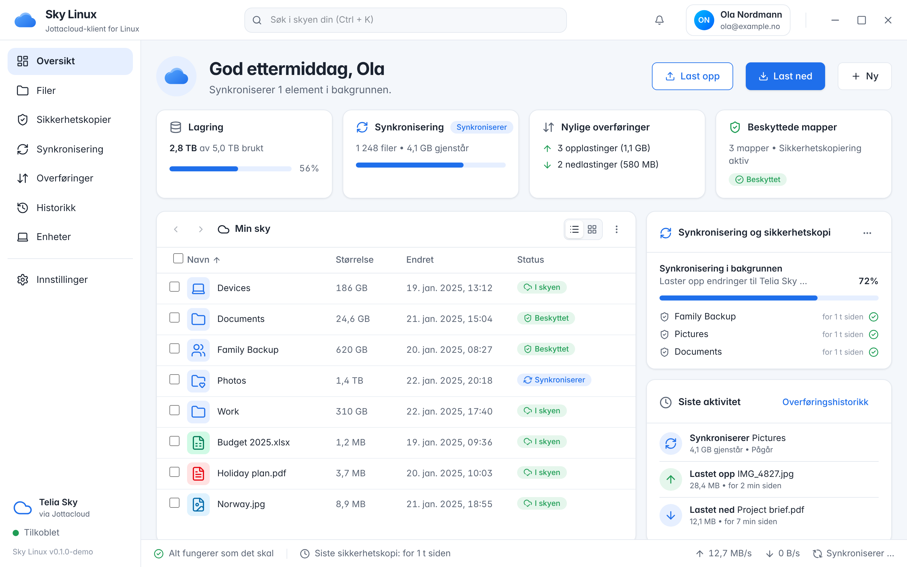

# Sky Linux

**A polished, open-source Linux desktop client for Telia Sky and other Jottacloud-powered cloud services.**

Browse your cloud files, back up folders automatically, and keep an eye on transfers. It should feel as easy as Dropbox or OneDrive, but for Telia Sky on Linux.



> **Status: early development (roadmap phases 0–2).** The core engine, background daemon and desktop UI are in place and tested against a real rclone process. Validation against a real Telia Sky account is the next step; see [docs/FEASIBILITY.md](docs/FEASIBILITY.md).
>
> Sky Linux is independent software. It is **not affiliated with, endorsed by or supported by Telia or Jottacloud.**

## What works today

| Area | State |
| --- | --- |
| Telia Sky sign-in (browser OAuth via rclone's `telia_no` white-label) | Implemented; still needs testing with a real account |
| Browse, search, rename, move, create folders, delete files (to trash) | ✅ tested end-to-end |
| Uploads & downloads with live progress, speed and ETA; cancel | ✅ |
| Downloads never overwrite local files (`name (1).ext`) | ✅ |
| Upload-only backups (on change / interval / manual); never delete remote files | ✅ |
| Restart recovery for interrupted transfers | ✅ |
| Background daemon that keeps running after the window closes | ✅ |
| Encrypted rclone config, with the password kept in the Secret Service keyring | ✅ |
| Norwegian Bokmål (default) and English UI, including translated Sky Core errors | ✅ |
| Two-way sync | 🚧 Phase 4: deliberately disabled until it can be made safe |
| DEB / RPM / AppImage packages | Configured (Tauri bundler); release CI to do |
| Flatpak / AUR | Drafts in `packaging/` |

## Architecture in one picture

```
┌──────────────────────┐   unix socket (0600, peer-UID checked)   ┌──────────────────────────┐
│ Sky Linux desktop    │ ───────── JSON lines ──────────────────▶ │ sky-daemon               │
│ Tauri 2 + React 19   │ ◀──────── events ─────────────────────── │  └ Sky Core (Rust)       │
│ (only a view)        │                                          │     accounts · transfers │
└──────────────────────┘                                          │     backups · history    │
                                                                  │     SQLite · keyring     │
                                                                  └────────────┬─────────────┘
                                                      RC API over private unix socket + random creds
                                                                  ┌────────────▼─────────────┐
                                                                  │ rclone rcd (bundled)     │──▶ Telia Sky / Jottacloud
                                                                  └──────────────────────────┘
```

Rclone handles cloud operations and Sky Core controls behaviour. The UI never talks to rclone. More detail is in [docs/ARCHITECTURE.md](docs/ARCHITECTURE.md).

## Repository layout

```
crates/sky-core       Rust engine: rclone adapter, supervisor, SQLite, events, IPC, backups
crates/sky-daemon     Background service binary (systemd user unit in packaging/systemd)
apps/desktop          Tauri 2 + React 19 + TypeScript + Tailwind 4 desktop app
  src-tauri           Rust shell: daemon bridge, tray, close-to-tray
packaging/            systemd unit, .desktop, AppStream metainfo, Flatpak, AUR
scripts/              feasibility.sh (real-account checks), prepare-sidecars.sh
docs/                 architecture, feasibility, security, packaging, roadmap
```

## Developing

Requirements: Rust ≥ 1.80, Node 22, rclone ≥ 1.66, and the Tauri Linux dependencies (`libwebkit2gtk-4.1-dev libayatana-appindicator3-dev librsvg2-dev libdbus-1-dev`).

```sh
# Engine and daemon
cargo test -p sky-core            # unit tests plus end-to-end tests against a real rclone process

# UI only, with a built-in demo backend (no account, no daemon)
cd apps/desktop && npm install && npm run dev     # http://localhost:1420
#   add ?onboarding to the URL to see the first-run flow

# Full app, using a local folder as the "cloud" (no account needed)
cargo run -p sky-daemon -- --local-cloud /tmp/my-test-cloud &
scripts/prepare-sidecars.sh       # builds sky-daemon and fetches a checksummed rclone
                                  # (re-run after daemon changes: Tauri copies this sidecar over target/)
cd apps/desktop && npm run tauri dev
```

To check a **real Telia Sky account**, run `scripts/feasibility.sh`. It uses an isolated rclone config, signs in through your browser, runs an upload/download round trip in a scratch folder, forces a token refresh, and writes a Markdown report.

## Translations

The UI defaults to **Norwegian Bokmål** (`apps/desktop/src/i18n/nb.ts`), with English (`en.ts`) as the reference and fallback. Strings use `{name}` placeholders and `one|other` plurals. A unit test checks that every language has the same keys, placeholders and plural forms. Sky Core errors carry stable `code` / `rule` values plus `params`, so they're translated in the UI rather than in Rust. To add a language, copy `en.ts`, translate it, and register it in `i18n/index.ts`.

## Principles

- **Safety first.** Backups use `rclone copy` semantics and never delete in the cloud. Two-way sync stays off until it has been thoroughly tested.
- **Reliable in the background.** Closing the window doesn't stop backups.
- **Secure by default.** Tokens are kept in an encrypted rclone config, rclone listens only on a private socket, and the app needs no root.
- **Human errors.** Technical failures are translated into clear, actionable messages, and the details stay one click away.

## License

GPL-3.0-or-later (proposed; see the open decisions in [docs/FEASIBILITY.md](docs/FEASIBILITY.md)). rclone is MIT-licensed and is bundled unmodified.
